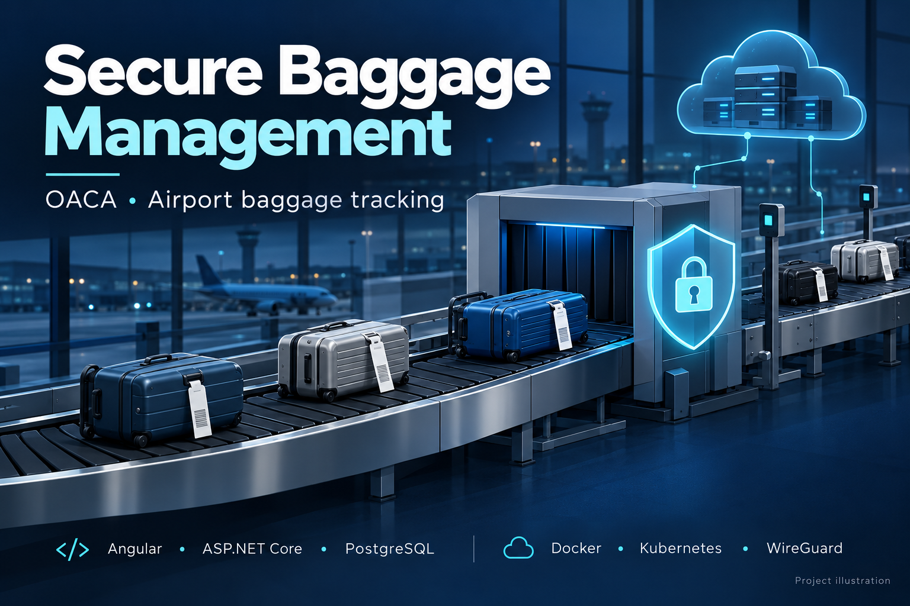
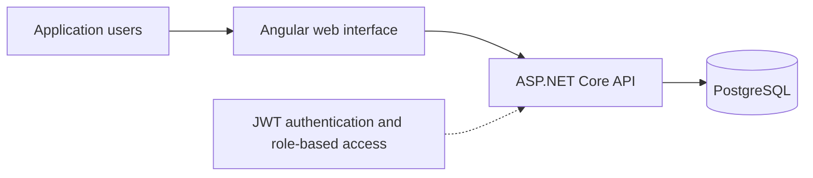

# Secure Airport Baggage Management

**Yessine Choura · OACA / AIST internship · July–August 2026**

## Overview

A full-stack baggage management and tracking project developed during an internship at the Office of Civil Aviation and Airports (OACA), AIST. The project combines an application for managing baggage with application access controls and a secured deployment environment.

This repository is a public portfolio presentation. The implementation is maintained in a separate private repository. The cover is an illustration of the project, not a screenshot of the application or a photograph of an OACA installation.

## Project scope

- Baggage management and tracking through a web application.
- Authentication using JWT and access controls based on user roles.
- HTTPS for application access and WireGuard VPN for secured network connectivity.
- Container deployment using Docker and Kubernetes (K3s).
- Hosting on an OVH VPS and validation of network filtering.

## Technology stack

| Area | Technologies |
| --- | --- |
| Frontend | Angular 22 |
| Backend | ASP.NET Core |
| Database | PostgreSQL 16 |
| Deployment | Docker, Kubernetes (K3s), OVH VPS |
| Access and network security | JWT, user roles, HTTPS, WireGuard |

## High-level application overview

The diagram describes the application components at a high level. HTTPS, VPN connectivity and network filtering are part of the deployment and access configuration; this presentation does not publish infrastructure addresses or operational configuration.

## My contribution

Developed the baggage management and tracking application, secured access and network connectivity, deployed the platform on an OVH VPS, and validated network filtering.

## Portfolio context

This presentation documents the internship project and its technology choices. It does not claim a continuously available public deployment or provide an airport production service.

[LinkedIn profile](https://www.linkedin.com/in/yessine-choura-a56b01267/)

---

**Résumé en français :** projet de gestion et de suivi sécurisé des bagages réalisé pendant un stage OACA / AIST. Application Angular / ASP.NET Core / PostgreSQL, sécurisation des accès et déploiement conteneurisé sur VPS OVH. Le code reste privé ; ce dépôt présente uniquement le projet.
